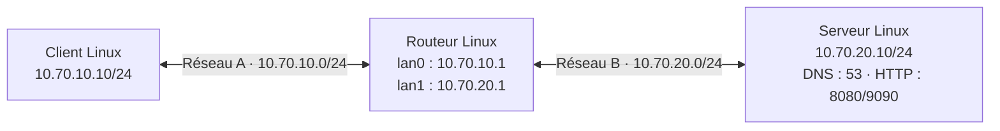

# Mini-lab Linux & Réseaux — Routage, DNS, HTTP et pare-feu

**Projet personnel d'apprentissage | Ingénierie des réseaux et des systèmes**

**En bref :** laboratoire Linux reproductible avec trois *network namespaces*, deux sous-réseaux IPv4, routage statique, DNS local, serveur HTTP, filtrage `iptables` et tests automatisés. Un projet concret pour pratiquer la configuration et le diagnostic d'infrastructures réseau.

Ce laboratoire **reproductible** modélise une petite infrastructure interne avec **trois environnements Linux isolés** : un poste client, un routeur et un serveur. Les machines communiquent à travers **deux sous-réseaux IPv4**. Le routeur applique une politique de **filtrage par défaut restrictive**, et le serveur fournit un **DNS local** ainsi qu'un service **HTTP**.

> **État du projet :** code et documentation publiés ; les tests statiques sont exécutables sans privilèges. La **validation réseau de bout en bout** doit être effectuée sur une VM ou un poste Linux compatible avec les *network namespaces*, ou via GitHub Actions. Ne pas présenter ce projet comme déjà déployé sur un environnement physique avant d'avoir réalisé ces essais.

## Architecture



Les trois « machines » sont des **espaces de noms réseau Linux (network namespaces)** du **même hôte**, pas trois ordinateurs, des VM complètes ou des conteneurs Docker. Des interfaces **veth** émulent les liaisons physiques. Cette technologie permet d'étudier les mêmes concepts de configuration réseau avec très peu de ressources.

| Élément | Adresse IPv4 | Rôle |
| --- | --- | --- |
| `irs-lab-client` · `eth0` | `10.70.10.10/24` | Client et tests |
| `irs-lab-router` · `lan0` | `10.70.10.1/24` | Routage côté client |
| `irs-lab-router` · `lan1` | `10.70.20.1/24` | Routage côté serveur |
| `irs-lab-server` · `eth0` | `10.70.20.10/24` | DNS et HTTP |

**Routage :** le client a une route vers `10.70.20.0/24` via `10.70.10.1` ; le serveur a une route vers `10.70.10.0/24` via `10.70.20.1`. Le routeur active `net.ipv4.ip_forward=1` **dans son namespace uniquement**. Il n'y a ni NAT, ni route par défaut, ni accès à Internet dans ce mini-lab.

## Fonctionnalités

- **Administration Linux :** création et suppression d'espaces réseau, configuration d'interfaces, lancement et supervision de services, collecte des journaux.
- **Réseaux IPv4 :** deux segments, routes statiques, transfert entre interfaces, diagnostic par `ip`, `ping`, `ss`.
- **DNS local :** `dnsmasq` répond à `service.lab.test` avec `10.70.20.10` ; aucune résolution externe n'est configurée.
- **HTTP :** service de test Python sur le port `8080`, avec une réponse vérifiable.
- **Pare-feu :** politique `DROP` sur la chaîne `FORWARD` du routeur, autorisant ICMP, DNS et HTTP `8080` ; `9090` est bloqué **depuis le client**, mais accessible **localement depuis le serveur**.
- **Tests :** six vérifications d'intégration via `scripts/lab.sh test` et tests statiques Python.

## Pré-requis

- **Linux** (une VM Ubuntu/Debian est recommandée) et accès `sudo`.
- Un noyau permettant de créer des **network namespaces**. Certains conteneurs et environnements WSL ne fournissent pas les privilèges nécessaires.
- Paquets : `iproute2`, `iputils-ping`, `iptables`, `dnsmasq-base`, `dnsutils`, `curl`, `python3`, `procps`.
- Aucun compte cloud, aucun équipement Cisco et aucun Docker nécessaires.

Sur Ubuntu/Debian :

```bash
sudo apt-get update
sudo apt-get install -y iproute2 iputils-ping iptables dnsmasq-base dnsutils curl python3 procps
```

**Sécurité :** le script ajoute trois namespaces dédiés, mais ne modifie **ni le pare-feu de l'hôte, ni ses routes, ni son serveur DNS**. Utiliser une VM personnelle de test pour éviter les collisions avec d'autres laboratoires. Les namespaces utilisés sont clairement nommés `irs-lab-*` ; ne pas lancer deux instances à la fois.

## Exécuter le lab

```bash
git clone https://github.com/K4ROUI/mini-lab-linux-reseaux.git
cd mini-lab-linux-reseaux

# Créer les interfaces, le routeur, les routes et les services
sudo bash scripts/lab.sh start

# Vérifier les communications autorisées et interdites
sudo bash scripts/lab.sh test

# Afficher les interfaces, les routes et les compteurs du firewall
sudo bash scripts/lab.sh status

# Arrêter les services et supprimer les namespaces
sudo bash scripts/lab.sh stop
```

### Tests d'intégration attendus

| Vérification | Attendu |
| --- | --- |
| 1. Ping depuis le client vers le serveur | Réussi |
| 2. HTTP `10.70.20.10:8080/health.txt` | Retourne `OK - laboratoire Linux et reseaux` |
| 3. DNS `service.lab.test` | Renvoie `10.70.20.10` |
| 4. HTTP `9090` depuis le serveur lui-même | Réussi |
| 5. HTTP `9090` depuis le client | Refusé ou bloqué par le routeur |
| 6. Vérification de `ip_forward` et de la politique `FORWARD DROP` | Conforme |

Le résultat effectif doit être confirmé **après exécution sur Linux**, ou dans l'onglet **Actions** une fois le projet publié sur GitHub. Ne pas confondre ces résultats attendus avec des essais déjà réalisés.

## Test de cohérence statique sans privilèges

```bash
python3 -m unittest discover -s tests -v
bash -n scripts/lab.sh scripts/firewall.sh
```

Ces tests vérifient les fichiers et les paramètres du dépôt, **sans créer d'interfaces ni envoyer de paquets**.

## Diagnostics à présenter en entretien

```bash
sudo ip -n irs-lab-client route show
sudo ip -n irs-lab-router -br address
sudo ip netns exec irs-lab-router iptables -L FORWARD -n -v
sudo ip netns exec irs-lab-server ss -lntu
sudo ip netns exec irs-lab-client dig @10.70.20.10 service.lab.test +short
sudo ip netns exec irs-lab-client curl -v http://10.70.20.10:8080/health.txt
```

Des explications sur ces commandes, ainsi que des scénarios d'incident et de résolution, sont dans [docs/diagnostic.md](docs/diagnostic.md).

## Documentation

- [Architecture et cheminement d'un paquet](docs/architecture.md)
- [Méthode de diagnostic d'une panne](docs/diagnostic.md)
- [Protocole de validation et limites](docs/validation.md)

## Structure

```text
mini-lab-linux-reseaux/
├── README.md
├── .gitignore
├── config/dnsmasq.conf
├── www/health.txt
├── scripts/
│   ├── lab.sh
│   └── firewall.sh
├── tests/test_structure.py
├── docs/
│   ├── architecture.md
│   ├── diagnostic.md
│   └── validation.md
└── .github/workflows/lab.yml
```

## Ce que ce projet démontre (après validation)

Construction d'un environnement Linux isolé, configuration de routes IPv4, compréhension de la chaîne `FORWARD`, supervision de services simples, analyse d'incidents de connectivité et automatisation de tests. C'est un **laboratoire d'apprentissage**, pas une architecture de production, un exercice de sécurité offensive ou une expérience professionnelle.
